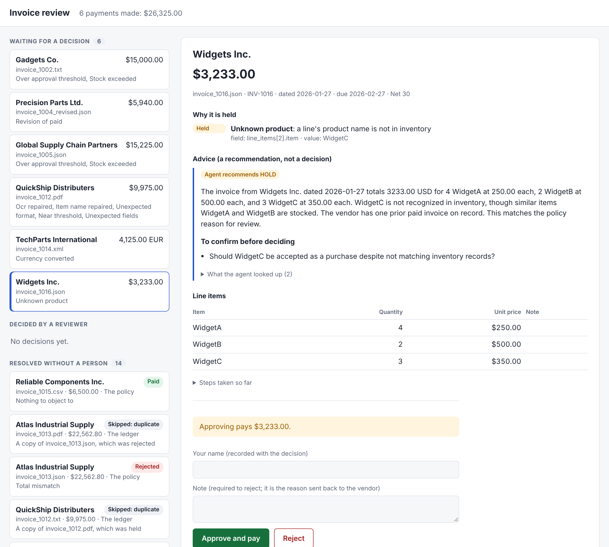
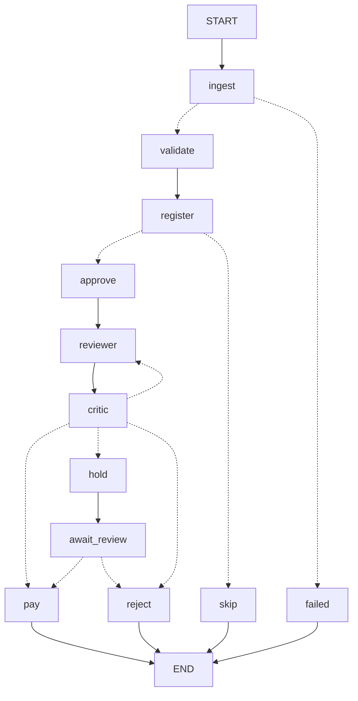

# Invoice processing for Acme Corp

A working prototype that takes a supplier invoice in any of five formats and carries it through
to one of three ends: paid, held for a named person, or rejected with reasons. It is my
submission for the Galatiq case; the brief is in [`ASSESSMENT.md`](ASSESSMENT.md).

It runs end to end on all 20 sample files, in about a second, with no API key.

## What it does with the 20 sample invoices

```bash
python main.py --invoice_path=data/invoices --offline
```

| Outcome | Invoices | Why |
|---|---|---|
| **Paid**, 6 invoices, $26,325.00 | 1001, 1004, 1006, 1010, 1011, 1015 | Nothing to object to. 1010 carries two warnings, which the reviewer agent read and explained |
| **Held** for a person, 6 | 1002, 1005 | More billed than is in stock, and $10,000 or over |
| | 1016 | WidgetC is not in inventory but is one letter from WidgetA and WidgetB: a misspelling, or a new product? |
| | 1012 | $25 under the $10,000 limit, after two scanner-damaged values and two product names were repaired |
| | 1014 | Billed in euros: shown as 4,125.00 EUR (~$4,480.16) and paid in euros when released |
| | 1004 revised | The original was already paid $1,890.00, so only the $4,050.00 difference can be owed |
| **Rejected**, 5 | 1003 | Four fraud signals: an item with no stock, a due date of "yesterday", "URGENT... penalties", a request for a wire |
| | 1007, 1013 | The stated total doesn't match the lines: $110.00 short on 1007, $50.00 over on 1013 |
| | 1009 | Negative quantity, negative total, no vendor |
| | 1008 | SuperGizmo and MegaSprocket: not in inventory, and nothing in inventory has a similar name |
| **Skipped** as duplicates, 3 | second copies of 1011, 1012, 1013 | The same invoice arrived in two formats; recognised by content, not file name |

Three things in that table are easy to get wrong, and each is a test in this repo:

- **1013 passes a stock check on every line and fails as a whole.** Three lines of WidgetA at 15,
  5 and 2 are each within the 15 in stock; together they are 22. Stock is summed per product.
- **Run the folder twice and nothing is paid twice.** The second run pays $0.00. Without the
  ledger, the policy alone approves $35,265.00 for this folder, $4,890.00 of it a double payment.
- **1003's "URGENT - pay immediately" changes nothing.** It is one of four signals counted by
  code. No model is asked whether the invoice looks suspicious.

[`demo/approvals-over-time.md`](demo/approvals-over-time.md) shows how these 20 outcomes changed
as each stage was built.

## Run it

Requires Python 3.10 or later.

```bash
pip install -e ".[dev]"
python main.py --invoice_path=data/invoices/invoice_1001.txt --offline     # one invoice
python main.py --invoice_path=data/invoices --offline                      # the whole folder
python -m web                                                              # the review screen, at http://127.0.0.1:8000
pytest                                                                     # 294 tests, about 10 seconds
```

`--offline` replays the model's recorded replies from `data/replays`, so no key is needed. To
call the model live, copy `.env.example` to `.env`, add an xAI key, and drop `--offline`.

`main.py` prints one JSON entry per file on stdout (the result, the decision, the reason, the
steps taken, and the invoice as read) and a summary on stderr:

```
6 held for review. Open the review screen with: python -m web --ledger ledger.db --checkpoints checkpoints.db
20 files: paid 6 now ($26,325.00). Ledger ledger.db: 6 payments ($26,325.00) in all.
```

Add `--trace` to watch an invoice move through the stages, one JSON line per step:

```
{"file": "invoice_1003.txt", "node": "ingest", "method": "llm", "model_attempts": 1}
{"file": "invoice_1003.txt", "node": "validate", "flags": ["UNPARSEABLE", "UNEXPECTED_FORMAT", ...]}
{"file": "invoice_1003.txt", "node": "approve", "outcome": "REJECT", "rule": "FRAUD_SIGNALS", "because": [...]}
{"file": "invoice_1003.txt", "node": "reject", "status": "REJECTED", "reasons": [...]}
```

Held invoices wait in a queue. The review screen lists them, and a named person decides:



Each invoice shows why it is held, the reviewer agent's advice and questions, and what approving
would pay: the $4,050.00 difference for 1004's revision, 4,125.00 EUR for 1014. A rejection needs
a note. The screen is a FastAPI backend and a TypeScript page with no framework; it listens on
this machine only and has no login.

The ledger persists between runs (`ledger.db`), which is why a second run pays nothing. `--fresh`
sets it aside and starts empty.

## How it works

One principle decides where everything goes:

> **Code decides what is true. The model handles what is unclear. A person owns what is risky.**



The stages are nodes in a [LangGraph](https://langchain-ai.github.io/langgraph/) graph
(`pipeline/graph.py`). Dotted arrows are branches chosen from the invoice's state.

| Stage | What it does | Who does it |
|---|---|---|
| **Ingest** | Reads the file into one standard invoice. JSON, CSV and XML are parsed. TXT and PDF are transcribed by the model, which copies values exactly as written | Code, and the model for free text |
| **Validate** | Repairs what the invoice itself proves, then runs about 40 kinds of check against the inventory, each raising a graded flag with its evidence | Code |
| **Register** | Asks the ledger whether this invoice, or a revision of it, has been seen | Code |
| **Approve** | A written policy turns the flags into the minimum outcome: approve, hold or reject | Code |
| **Reviewer** | Looks into holds and warned approvals with lookup tools, and writes the reason for a person | The model |
| **Critic** | Checks that reason against the evidence. Problems send it back, twice at most | Code, then the model |
| **Pay, hold, reject** | Pays once through the ledger; or queues the invoice for a person and pauses; or records the rejection | Code, and a person for holds |

### Where the model is used, and what it cannot do

Three places, each fenced by code.

| Use | What the model does | What stops it going wrong |
|---|---|---|
| **Extraction** | Transcribes a TXT or PDF into a fixed JSON schema, copying values as written, errors included | Every value must appear in the document (grounding). One that doesn't is sent back with the specific complaint, three attempts at most. A retry that drops data is never used |
| **Reviewer agent** | Chooses lookups (stock, similar products, a vendor's history), recommends, and explains | It can add a hold to an approval and nothing else. It cannot approve, reject or pay. Once it adds a hold, only a person can remove it |
| **Critic** | Looks for claims the evidence doesn't support | Checks in code run first and count on their own: every figure must be in the invoice, the flags or a lookup result |

The rule underneath all three: **a model can make the system stricter, never looser.** If the
model is unreachable, the policy still decides every invoice.

Invoice text is written by the vendor, and may be written to persuade. It reaches the model only
inside delimited blocks that can't be closed from inside, and the worst a successful injection
can cause is an extra hold.

### Self-correction, measured

Two loops, each judged by code and each with a hard stop.

| Loop | Triggered by | On the samples |
|---|---|---|
| Extraction retry | A transcribed value that isn't in the document | 1 of 10 text files needed it (1002), and the second attempt was clean |
| Reviewer and critic | A figure, flag code or claim the evidence doesn't support | 1 of 7 assessments was sent back (1010), by a check in code |

Repairs are a third kind, with no model: a scanner's `O` for `0` is read only when another value
on the invoice confirms it. On 1012, `$3,500.O0` is confirmed by 7 × $500.

`python -m extraction.report data/invoices` compares every file with and without self-correction:
flags that would hold an invoice fall from 41 to 32, for one extra model call, with 3 files
better and none worse.

## What the brief asked for

| Requirement | Where |
|---|---|
| Ingestion from PDFs and text, with typos and missing data | `extraction/`, `normalizer/parsing.py`. Also JSON, both CSV shapes, and the XML file the brief doesn't mention |
| Validation against a SQLite inventory | `normalizer/checks.py`, read-only against `inventory.db` |
| Approval with rules and a reflection or critique loop | `approval/policy.py`, `approval/reviewer.py`, `approval/critic.py` |
| Payment through the mock function; rejections logged with reasons | `ledger/`: `mock_payment` called at most once per invoice |
| Grok as the reasoning engine | `extraction/providers.py`: xAI's API, `grok-4`, standard library only |
| Multi-agent orchestration | LangGraph: `pipeline/graph.py` |
| Function calling, structured outputs, self-correction loops | The reviewer's tools; strict JSON schemas on every model call; the two loops above |
| No internet for external APIs; simulate locally | Inventory, payment and exchange rates are local mocks, and recorded model replies make the whole run offline |
| `python main.py --invoice_path=...` with structured logs | `main.py`; `--trace` for the logs. The brief's example path doesn't exist, so that case lists the files that do |

Two of the four stages the brief names use a model. Validation and payment are code on purpose:
arithmetic, stock and "has this been paid" have right answers.

## Assumptions

The brief leaves these open. Each is a decision I made, and would confirm with Acme in week one.

- **Acme is the buyer.** These are suppliers' invoices that Acme pays. Checking them against
  stock on hand is what the brief asks for, and I treat stock as a stand-in for "quantity we can
  confirm receiving". A real version would match each invoice to its purchase order and goods receipt.
- **Stock is checked per invoice and doesn't run down** across invoices. The brief's own examples
  require this.
- **"Over $10K" includes exactly $10,000.** The cautious reading.
- **A product that isn't in inventory is rejected, unless its name is close to one that is.**
  A near name ("WidgtA", "WidgetC") may be a misspelling, so a person decides. A name that
  resembles nothing Acme stocks is rejected outright.
- **An invoice that names no currency is in US dollars,** and says so in a note. A named foreign
  currency is paid in that currency, with a dollar estimate for the reviewer.
- **Files are processed in name order,** so 1004 is paid before its revision is read, and the
  revision is held for the difference.
- **A reviewer is whoever types their name.** There is no login, and the review screen is served
  to this machine only.

## Not built, and why

| Not built | Why |
|---|---|
| OCR for scanned images | The sample PDFs have a text layer. A scan is refused with a message saying so |
| Matching to purchase orders and goods receipts | No such data in the brief. It is the first thing to add with real systems |
| A vendor list | Would catch a changed bank account, a billing currency, and a vendor name spelled two ways |
| Real exchange rates | The brief rules out internet access. `rates/` is a local mock with made-up rates |
| Retrying a failed payment | `mock_payment` always succeeds. An unconfirmed payment is held for a person, never resent blindly |
| Processing invoices from the browser | The screen is for decisions. Invoices are still processed by `main.py` |
| Deployment, logins, concurrency | Out of scope for a local prototype |

## What I would not claim

- **The percentages don't generalise.** Twenty files, built to be awkward.
- **The model critic has not earned trust.** Across three recordings it found no real problem,
  and raised four that weren't until its instructions were corrected. The checks in code are the
  dependable part. [`docs/approval.md`](docs/approval.md) has the detail.
- **Model output varies between runs,** even at temperature 0. The recordings pin one run, and
  tests fail if a re-recording behaves differently.

## Where things are

| Path | What |
|---|---|
| `main.py` | Processes invoices |
| `web/` | The review screen: FastAPI backend, TypeScript page. [Reference](docs/ledger-and-review.md#review-queue) |
| `normalizer/` | Parsing, repairs, checks and flag severities. Standard library only. [Reference](docs/normalizer.md) |
| `extraction/` | Model transcription, grounding, the retry loop, the provider, recordings. [Reference](docs/extraction.md) |
| `approval/` | Policy, reviewer agent, critic. [Reference](docs/approval.md) |
| `ledger/`, `rates/` | What has been seen and paid; the mock rate service. [Reference](docs/ledger-and-review.md) |
| `pipeline/` | The graph, checkpoints, holding and releasing. [Reference](docs/pipeline.md) |
| `data/invoices/`, `data/replays/` | The sample invoices; the model's recorded replies |
| `demo/` | Numbers and examples for a walkthrough, each with the command that reproduces it |
| `tests/` | 294 tests. Each one's first line says the behaviour it pins |
| `ASSESSMENT.md` | The brief |
