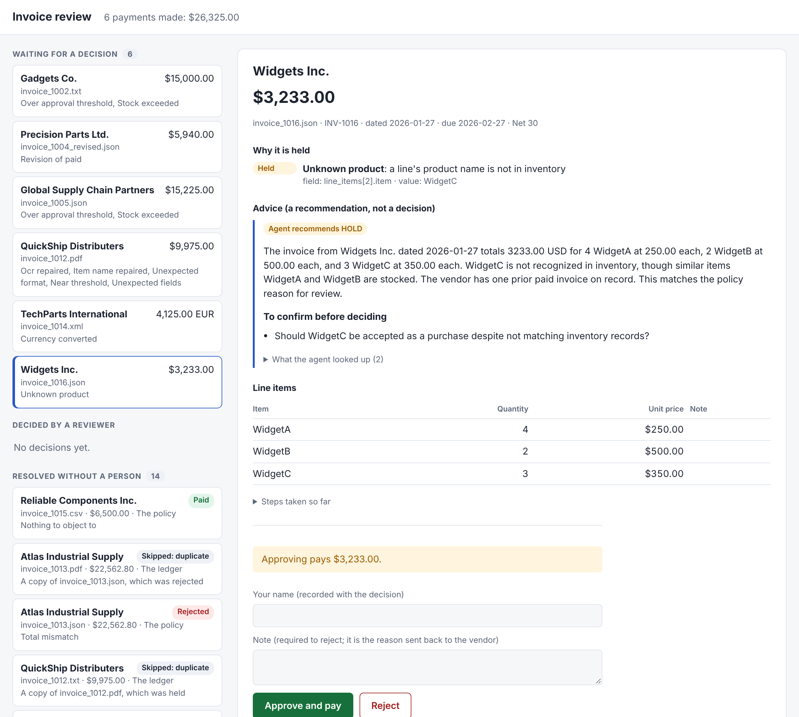
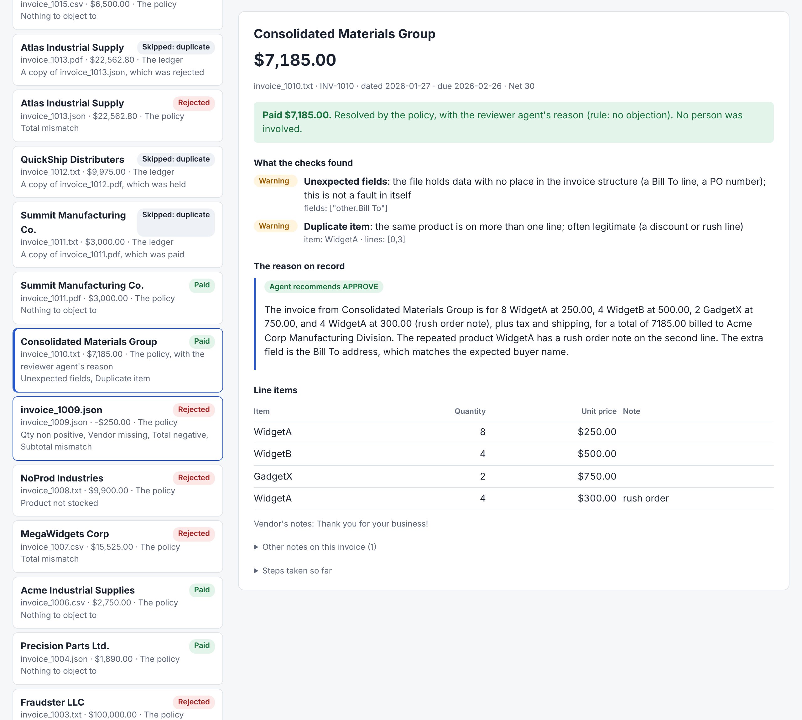

# Ledger, payment, review queue and exchange rates

Part of the reference documentation. Start with the [README](../README.md).

## Ledger and payment

`ledger/` is the only part that compares an invoice with others. It is one SQLite file holding
every invoice processed and every payment made.

**Identity.** An invoice is known by its vendor, number and revision, each stripped of formatting:
`INV-1012`, `INV 1012` and `1012` are one number, and `R1` is revision 1. Two vendors can both
issue a 1001, so the vendor is part of it.

**Same invoice, different file.** Sameness is judged on content: a fingerprint of the number,
revision, total and each line's item, quantity and price. A PDF and a TXT of one invoice
match although the PDF omits the subtotal line.

| The ledger finds | What happens |
|---|---|
| Never seen | Recorded; goes on to approval |
| This same file, processed before | Skipped as `ALREADY_PROCESSED`, with the earlier outcome |
| Another file with the same invoice and content | Skipped as `SKIPPED_DUPLICATE`, pointing at the first |
| Same vendor, number and revision, different content | `DUPLICATE_CONFLICT` (REVIEW): held. The first record is untouched |
| A revision of an invoice with any earlier revision paid | `REVISION_OF_PAID` (REVIEW), with everything paid so far and the difference: held. Earlier revisions still held are replaced by it |
| A revision of an invoice not paid | The earlier one is marked superseded; the revision is judged on its own (`SUPERSEDES_UNPAID`, INFO) |
| An older revision than a live one on record | Skipped as `SKIPPED_SUPERSEDED`. If every newer revision was rejected, it is processed normally |
| The same number and content under a different vendor name | `POSSIBLE_DUPLICATE` (REVIEW): held, pointing at the first |
| Recorded by an earlier run that stopped before deciding it | Finished now, not skipped |

**Paying once.** `mock_payment` is the brief's function. Each payment has a key built from the
invoice's identity, and the ledger holds at most one payment per key. The payment row is written
as PENDING before the payment function is called and marked PAID after it returns. If the call
fails or the process dies in between, the PENDING row stops a blind retry, since the first call
may have gone through. The invoice is reported as `PAYMENT_UNCONFIRMED` for a person to check
with the bank, a revision of it is treated like a revision of a paid invoice, and the rest of
the batch carries on. A payment that could not be attempted at all (a payment function with no
currency argument, asked to pay euros) is different: nothing is locked, it is reported as
`PAYMENT_NOT_SENT`, and the invoice is taken up again on the next run.

### The sample folder, in file order

```bash
python main.py --invoice_path=data/invoices --offline --fresh
```

| Result | Invoices |
|---|---|
| PAID, 6 invoices, $26,325.00 | 1001, 1004, 1006, 1010, 1011 (pdf), 1015 |
| HELD, 6 | 1002, 1005, 1012 (pdf), 1014, 1016, and 1004 revised (the original was already paid; $4,050.00 difference) |
| REJECTED, 5 | 1003, 1007, 1008, 1009, 1013 (json) |
| SKIPPED_DUPLICATE, 3 | 1011 (txt), 1012 (txt), 1013 (pdf) |

Run it again and nothing is paid: 17 files are `ALREADY_PROCESSED` and the 3 second copies are
still duplicates.

Files are processed one at a time in name order, so what an invoice is compared with depends on
what came before it. 1004 is paid before its revision is read, which is why the revision is held
for the difference. Reading the whole folder first and paying only the latest revision is a
possible refinement; holding the revision is the safe behaviour either way.

## Review queue

An invoice the policy holds is not finished: it waits for a person. The review screen is how
they see what is waiting and decide it.

```bash
python -m web            # then open http://127.0.0.1:8000
```



An invoice resolved without a person, opened from the list:



The left column lists what is waiting, what a reviewer has decided (each can be opened to see
what they decided on), and what was resolved
without a person: paid or rejected by the policy (with the reviewer agent's reason where it wrote
one), or skipped by the ledger as a second copy. Any of those can be opened to see the same
evidence, read-only, with how it ended in place of the decision form. A search box and an outcome
filter at the top narrow all three lists: the search matches vendor, file name, reason (as a flag
code or in words), note, reviewer and amount (as stored or as shown, so `15,000` finds
$15,000.00), and each list then shows "2 of 14". The two lists of finished invoices show 200
rows each, newest first, with a "Show 200 more" row when there are more. The narrowing is done by the ledger in SQL (`Ledger.find_runs`,
`find_waiting`, `find_decided`): each row has a `search` column written with it, a search is one
`LIKE` per word, and the outcome and the limit are part of the same query. The right shows one invoice:
why it is held, with each flag explained; the reviewer agent's advice, its questions and what it
looked up; the lines; and what approving would pay. The reviewer enters their name, and a note if
rejecting.

**How it is built.** `web/app.py` is a FastAPI application with five routes, and it adds no rules
of its own: deciding calls `pipeline.release`, where everything below is enforced.

| Route | Does |
|---|---|
| `GET /api/queue` | What is waiting, what was decided, what was resolved without a person, and what has been paid. `?q=` searches; `?outcome=` keeps one of waiting, paid, rejected, skipped, other |
| `GET /api/runs/{run}` | One finished run in full: the flags, the reason on record, and how it ended |
| `GET /api/queue/{id}` | One held invoice in full |
| `POST /api/queue/{id}/decision` | `{"action": "approve" or "reject", "reviewer", "note"}`. A refusal is a 400 with the reason |
| `POST /api/queue/{id}/reopen` | Puts back an invoice whose saved run is gone, to be processed again |

The page is plain TypeScript with no framework (`web/frontend/src/app.ts`), compiled to
`web/static/app.js`. The compiled file is committed, so running the screen needs only Python;
`npm install && npm run build` in `web/frontend` rebuilds it. Vendor text is put on the page as
text, never as HTML. There is no login: the server listens on this machine only, refuses
requests addressed to any other host name, and a reviewer is whoever types their name.

After a decision the screen says what happened, from the server's answer: paid, rejected, or a
payment that was sent but did not confirm, which is shown as a warning to check with the bank
and never as paid. If two people decide the same invoice at once, the first decision stands and
the second is refused.

- **Deciding resumes the run.** Approve continues the paused run into payment; reject records the
  reviewer's note as the reason. The reviewer's name, decision and note are kept in the ledger,
  and the policy's original decision stays on the record beside them.
- **A person can overrule a hold, within limits.** Some holds can only be rejected, because the
  invoice can't be paid correctly whoever approves it: one with no invoice number, or one that
  conflicts with an invoice already on record. The screen says why, and the Approve button is off.
- **An invoice in another currency is approved like any other.** It is listed with its dollar
  estimate, `4,125.00 EUR (~$4,480.16)`, from the [rate service](ledger-and-review.md#exchange-rates). The reviewer
  types no amount and no rate. Approval pays the invoiced amount in the invoiced currency.
- **An invoice the rate service has no rate for waits.** It can't be approved until a rate exists
  (the service is asked again when the reviewer comes to it), since its cost isn't known.
- **A revision of a paid invoice is released for the difference.** Approving 1004's revision
  ($5,940.00) after the original was paid ($1,890.00) pays $4,050.00.
- **A rejection needs a note,** since it is what goes back to the vendor.
- **A newer revision clears the older one from the queue,** so the reviewer sees one invoice.

The policy can never be loosened by a model. It can be overruled by a named person, and that is
recorded.

A held invoice lives in two files: its queue entry in the ledger, and its paused run in the
checkpoints. Three things keep them from drifting apart:

- **A decision that was recorded but not carried out stays in the list,** marked as such.
  Repeating it finishes it, with the reviewer and note first recorded.
- **A held invoice whose saved run is missing is put back.** Deciding it reports the loss, closes
  the entry, and returns the invoice to unprocessed, so running its file again checks and queues
  it afresh.
- **The review screen never creates a checkpoints file.** Started with a path that has no saved
  runs it says so, and decides nothing.

Runs that reach an outcome have their saved states deleted; only paused runs are kept. What a
finished run found and how it ended is written to the ledger's `runs` table as it ends, one row
per file, which is what the screen reads for resolved invoices. An outcome a file reaches on every
run (a copy skipped again, a file that still can't be read) is logged the first time only. If the
log can't be written the run still ends as it did, with a warning: a payment that went out is
never reported as a failed run.

## Exchange rates

An invoice billed in another currency (1014, in EUR) is paid in that currency: the vendor is owed
what they billed, and dollars at some rate would leave them short or over once their bank
converted back. The system still needs a dollar figure, to judge the invoice against the dollar
thresholds and to show a reviewer what it costs. That estimate comes from a rate service.

**The rate service is a mock.** The brief rules out internet access, so, like the inventory
database and `mock_payment`, it is simulated locally: `rates/` reads a small SQLite table,
`rates.db`, which `python seed_rates.py` fills (and `main.py` creates on first run). **The seeded
rates are made up**, for EUR, GBP, CAD and JPY in the weeks the samples fall in. Everything that
needs a rate calls one method, `usd_rate(currency, on)`; a real service is one more class with
that method.

- **Lookup:** the most recent rate on or before the invoice date. A rate dated later is never used.
- **With a rate:** `CURRENCY_CONVERTED` (REVIEW) carries the rate, its date and the dollar
  estimate. The `$10,000` threshold and near-threshold checks run on the estimate, so 9,500 EUR
  is over the limit. The invoice is held so a person sees each foreign-currency payment; setting
  the flag to WARN in `severity.py` would let clean ones through on the estimate.
- **Without a usable rate** (currency not carried, no rate that early, one more than 7 days old,
  or the service failing): `CURRENCY_UNSUPPORTED` (REVIEW) with the reason. No threshold check is
  possible. A failing rate service costs that invoice its estimate; the batch carries on.
- **An invoice with no date** is priced as of today, so an old rate is caught as stale and not
  used on trust.
- **Payment:** `mock_payment(vendor, amount, currency)`. Dollar payments still use the brief's
  two-argument call. The ledger records each payment's currency and never adds currencies together.

The estimate is an estimate: the real dollar cost is whatever the bank charges when the payment
settles.
